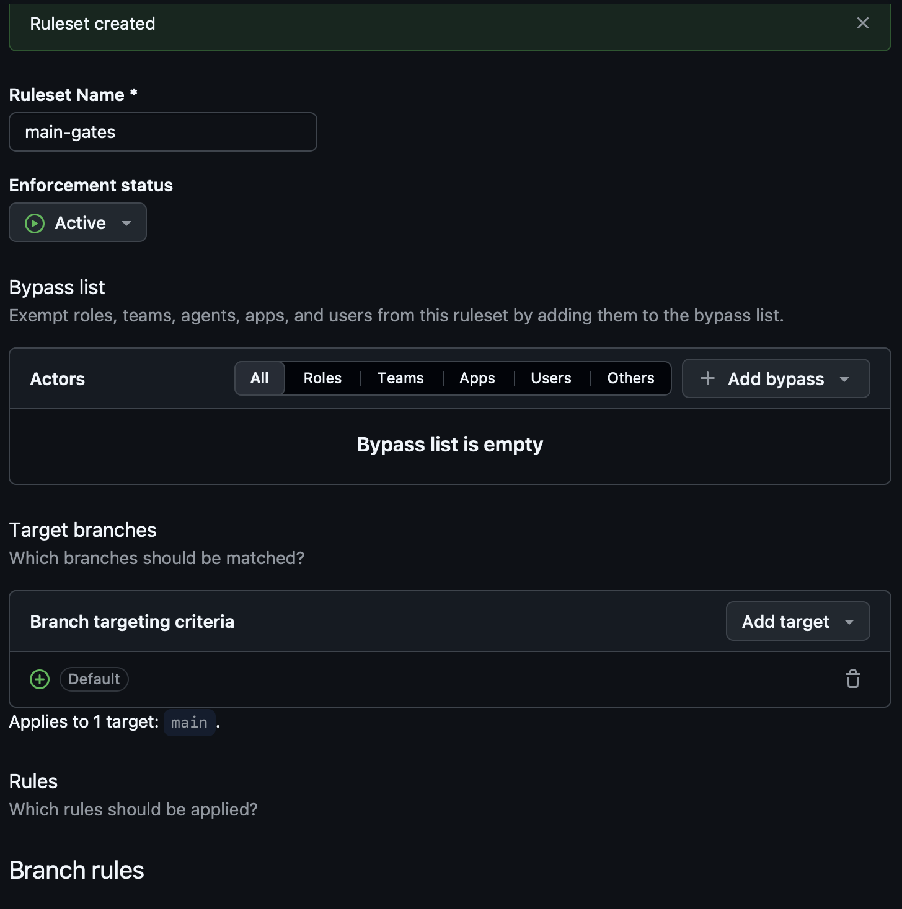
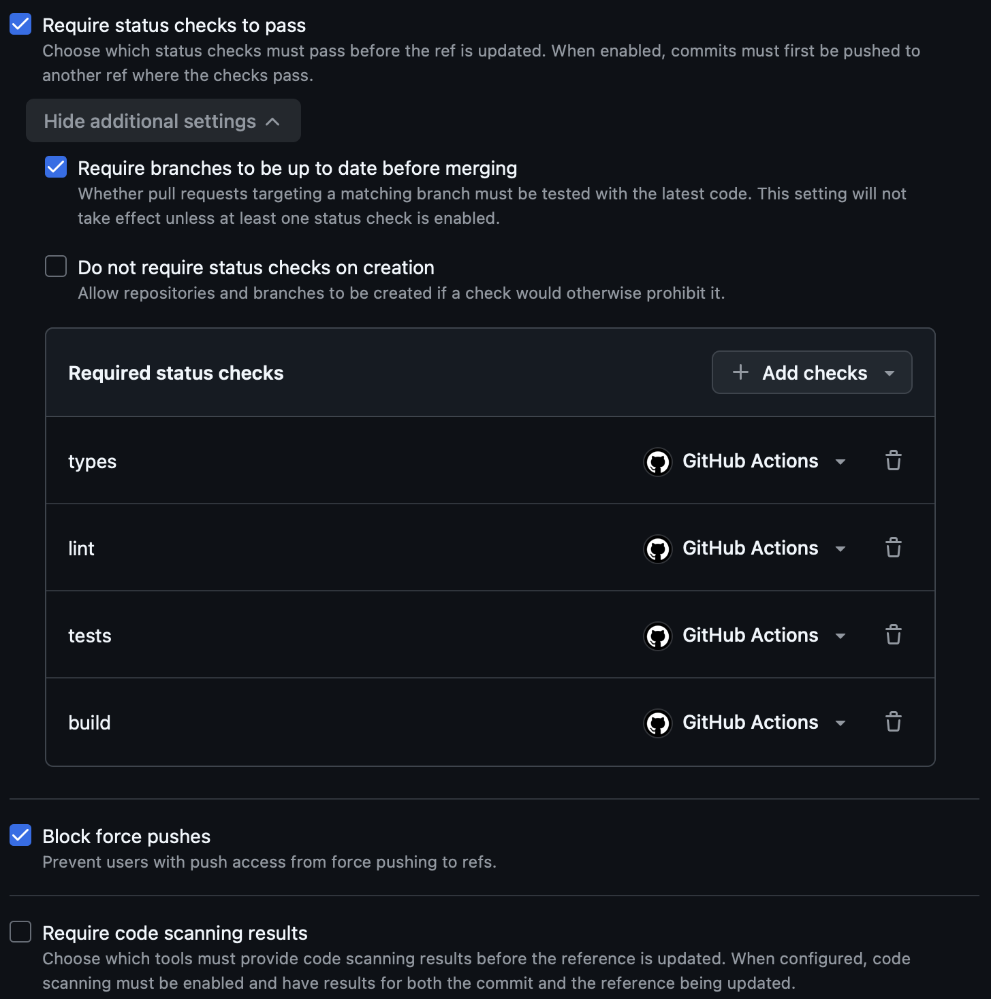
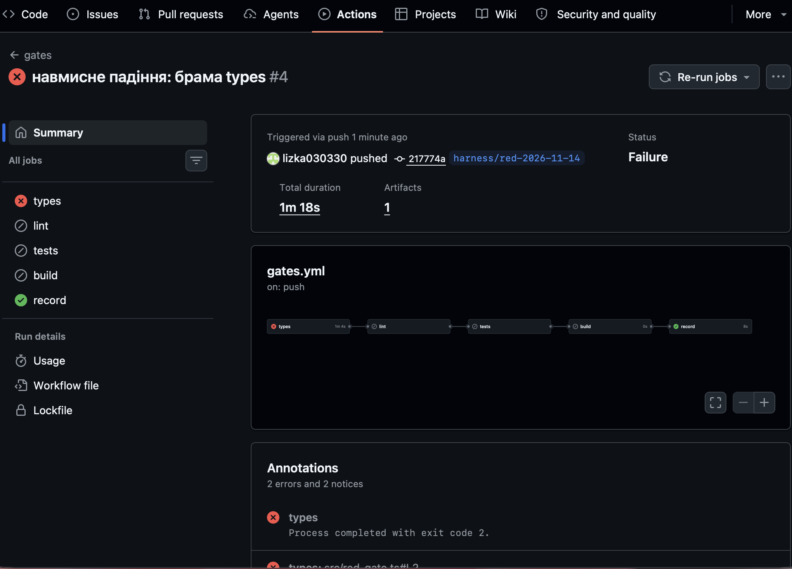
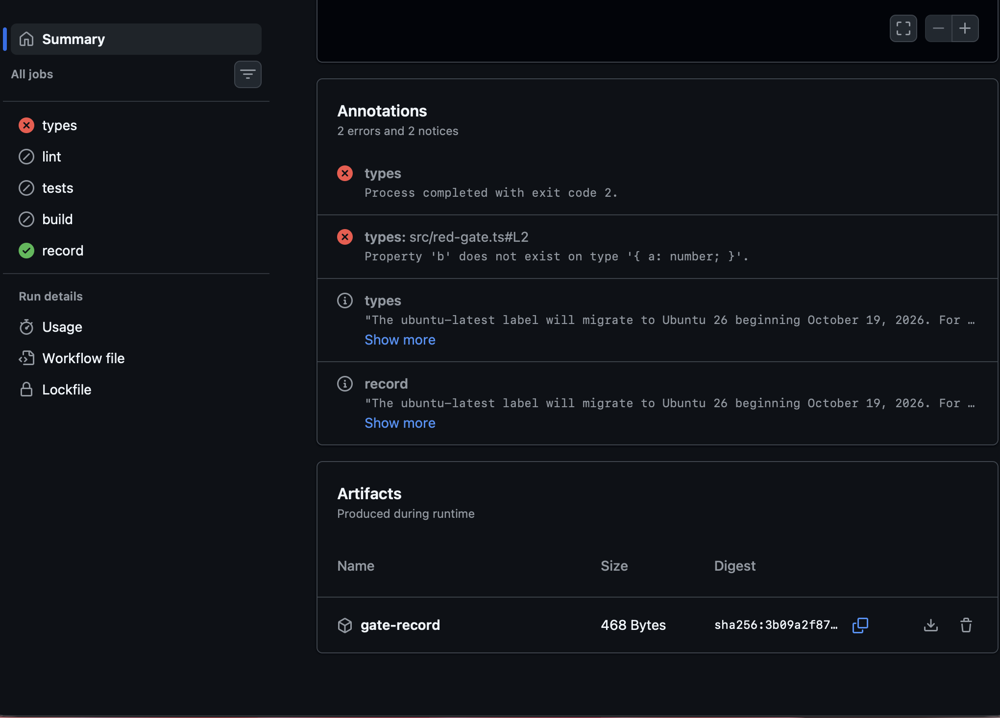
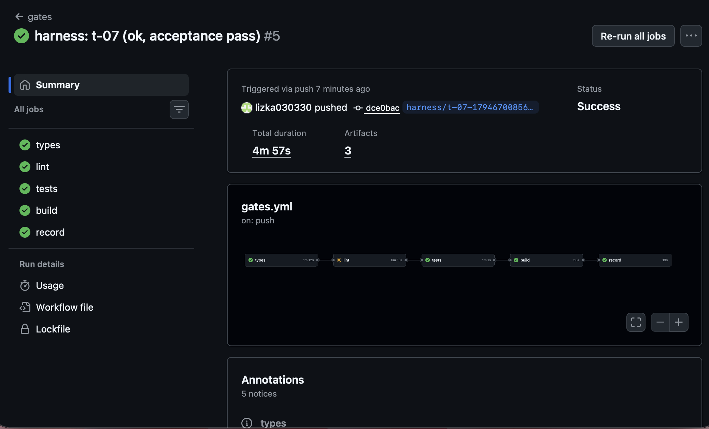

# Ланцюг детермінованих брам

- Workflow: [`.github/workflows/gates.yml`](../../.github/workflows/gates.yml); свідок — [`scripts/harness/record-gates.mjs`](../../scripts/harness/record-gates.mjs), тест — [`tests/harness/record-gates.test.ts`](../../tests/harness/record-gates.test.ts)
- Порядок: **types → lint → tests → build → record**
- Чому такий порядок: найдешевша й найвизначеніша перевірка — перша. `tsc --noEmit` за ~1 хв (разом із `npm ci`) відповідає однозначно, тоді як `next build` — найдорожча. Поки types червоні, решта не запускається (`needs`), тож зламані типи не оплачуються хвилинами лінту, тестів і збірки — у червоному прогоні нижче весь ланцюг коштував 1 хв 18 с замість ~5 хв зеленого.
- Concurrency: `group: ${{ github.workflow }}-${{ github.ref }}`, `cancel-in-progress: true` — новий push у ту саму гілку скасовує попередній прогін.
- Тригери: кожен `push` у будь-яку гілку (зокрема гілки агента `harness/<id>-<мітка>`) і кожен `pull_request`.
- Версії дій: `actions/checkout@v7` і `actions/setup-node@v7` (Node 24) — ті самі, що вже працюють у `ci.yml` цього репозиторію; у каркасі методички — `checkout@v6` і `<МАЖОР>` для setup-node. Артефакти: `actions/upload-artifact@v7` / `actions/download-artifact@v8` (мажори різні — так і має бути).

## 1. Таблиця брам
| Брама | Що доводить | Чого коштує (хв) | Що пише |
|---|---|---|---|
| types | код узгоджений із власними типами: немає звернень до полів, яких немає (`tsc --noEmit`, strict, `noUncheckedIndexedAccess`) | ~1 (більшість — `npm ci`); `timeout-minutes: 5` | `verdict=pass` у вихід задачі; вивід `tsc` у лог прогону (червоний — анотація `src/red-gate.ts#L2`) |
| lint | правила, яких не видно з типів: невикористане, недозволені імпорти, стиль (`eslint .`) | ~1; `timeout-minutes: 5` | `verdict`; перелік порушень у лог |
| tests | поведінка не змінилася там, де не мала; критерії приймання задачі справді виконані (`vitest run`, 171+ тест без мережі) | ~1; `timeout-minutes: 10` | `verdict`; артефакт `gate-tests` з `docs/lab3/runs/**` (журнали прогонів харнеса) |
| build | збирається не лише в голові автора: немає відсутніх залежностей і неімпортованих модулів (`next build`) | ~1–2, найдорожча; `timeout-minutes: 15` | `verdict`; артефакт `gate-build` з `.next/build-manifest.json` (Next збирає в `.next/`, а не в `dist/` з каркаса; повна тека — сотні МБ) |
| record | не брама, а свідок: звʼязує вердикти з прогоном харнеса; `if: ${{ !cancelled() }}` — виконується й на червоному прогоні | < 0,5; `timeout-minutes: 5` | `gate-record.json` (вердикти, `run_url`, `sha`, `ref`) і копія `run.json` прогону харнеса з полем `gates` — артефакт `gate-record` |

Вердикт кожної брами в `gate-record.json`: факт — `needs.<job>.result` (видно й на впалій брамі), а `outputs.verdict` — підтвердження, що брама дійшла до кінця свідомо. `success` + `verdict=pass` → `pass`; `failure` → `fail`; `skipped`/`cancelled` → `skipped`; `success` без підтвердження → `fail` (не довіряємо). Це правило перевіряє `tests/harness/record-gates.test.ts` без мережі.

## 2. Обовʼязкові перевірки
Набір правил **`main-gates`** на `main` (Settings → Rules → Rulesets), статус **Active**, ціль — Default branch (`main`), обхідний список порожній:
- «Require status checks to pass» — перелічені рівно чотири брами: **types, lint, tests, build** (джерело — GitHub Actions). `record` не обовʼязкова: це свідок, а не брама.
- «Require branches to be up to date before merging» — **увімкнено**: зелений прогін на старій основі не дає права на злиття, гілку спершу треба підтягнути до `main`.
- Також увімкнено типові «Restrict deletions» і «Block force pushes».




## 3. Навмисне падіння
- Гілка: [`harness/red-2026-11-14`](https://github.com/lizka030330/Lab-1-Agent/tree/harness/red-2026-11-14) (коміт `217774a`, не зливається — це доказ) · що зламано: один новий файл `src/red-gate.ts` зі зверненням до поля `b`, якого немає в типі `{ a: number }`.
- Прогін: https://github.com/lizka030330/Lab-1-Agent/actions/runs/43609576792 (gates #4, push, статус **Failure**, 1 хв 18 с)
- Очікувано червона брама: **types** — `src/red-gate.ts#L2: Property 'b' does not exist on type '{ a: number; }'`, `Process completed with exit code 2`.
- Що показали наступні брами: **lint, tests, build — skipped**, а не failure: `needs` не розірвані.
- record виконалась: **так** (зелена) · артефакт `gate-record` (468 байт) — витяг нижче.




Витяг з `gate-record.json` червоного прогону (повністю — [`gate-record-red/gate-record.json`](gate-record-red/gate-record.json)):
```json
"ref": "refs/heads/harness/red-2026-11-14",
"gates": { "types": "fail", "lint": "skipped", "tests": "skipped", "build": "skipped" },
"raw":   { "types": { "result": "failure", "verdict_output": null }, … },
"all_pass": false,
"harness_runs": []
```
`verdict_output` у types — `null`: крок з `echo "verdict=pass"` не виконався, тому факт падіння взято з `needs.types.result`, а не з виходу. `harness_runs` порожній, бо ця гілка — не прогін агента.

## 4. Звʼязок із фабрикою
Задача **t-07** (тести для `errorPct`) прогнана фабрикою 14.11.2026 **з відправкою гілки**: `npx tsx scripts/harness/run-queue.ts docs/lab3/tasks.jsonl --id t-07`.
- Прогін харнеса: `task_id` **t-07**, агент `opencode+google/gemini-3.6-flash`, `exit_status` ok, 97,6 с, acceptance **pass**, токени 50 093 / 1 350; журнал — [`docs/lab3/runs/t-07-1794670085832/run.json`](runs/t-07-1794670085832/run.json).
- Гілка агента [`harness/t-07-1794670085676`](https://github.com/lizka030330/Lab-1-Agent/tree/harness/t-07-1794670085676) (коміт `dce0bac`) містить зміну агента і той самий `run.json` — черга кладе його в гілку, щоб `record` знайшов прогін.
- Прогін брам на цій гілці: https://github.com/lizka030330/Lab-1-Agent/actions/runs/43610472809 (gates #5, push, статус **Success**: types, lint, tests, build ✓, record ✓; 3 артефакти).



Витяг з `gate-record.json` зеленого прогону (повністю — [`gate-record-green/gate-record.json`](gate-record-green/gate-record.json)):
```json
"ref": "refs/heads/harness/t-07-1794670085676",
"gates": { "types": "pass", "lint": "pass", "tests": "pass", "build": "pass" },
"raw":   { "types": { "result": "success", "verdict_output": "pass" }, … },
"all_pass": true,
"harness_runs": [ { "task_id": "t-07", "run_json": "docs/lab3/runs/t-07-1794670085832/run.json", "acceptance_passed": true } ]
```
Той самий `run.json` кроку 00 після `record` — з заповненим полем `gates` (повністю — [`gate-record-green/t-07-1794670085832/run.json`](gate-record-green/t-07-1794670085832/run.json)):
```json
"task_id": "t-07",
"acceptance_passed": true,
"gates": { "types": "pass", "lint": "pass", "tests": "pass", "build": "pass" }
```
Звʼязок у обидва боки: `gate-record.json` вказує на `run.json` за `task_id`, а `run.json` отримує вердикти брам. Acceptance задачі (локально, у дереві прогону) і брами (у CI, на чистому `npm ci`) дали однаковий висновок — зміну агента можна зливати.
